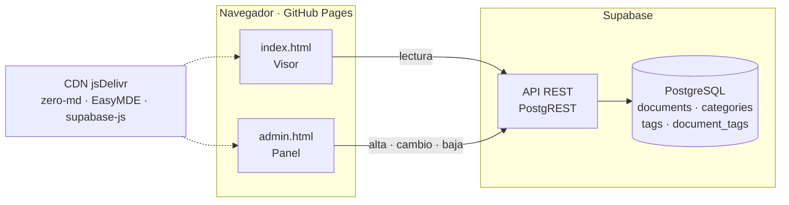

# Codex

<p align="center">
  
</p>

<p align="center">
  Base de conocimiento en Markdown con panel de administración, sobre Supabase y publicada como sitio estático.<br />
  <a href="https://bernardo-qg.github.io/codex-viewer/"><strong>Ver sitio</strong></a> ·
  <a href="docs/adr/README.md">Decisiones de arquitectura</a> ·
  <a href="README.md">Read in English</a>
</p>

## Funcionalidades

**Visor**

- Secciones anidadas en un árbol plegable, con la ruta (Desarrollo › Backend) en cada documento
- Etiquetas que cruzan secciones: clic en una para filtrar, o busca `#etiqueta`
- Búsqueda instantánea por título, resumen, sección y etiquetas (`/` para enfocar, `Enter` para abrir, `Esc` para limpiar)
- Resumen de una línea bajo el título, usado también como descripción al compartir
- Tarjetas de anterior / siguiente al final de cada documento, en el orden del menú (también con `←` `→`)
- Los enlaces entre documentos abren sin recargar, ya sea `?doc=git`, `?doc=git#stash` o el formato anterior `git.md`
- Índice de cada documento que resalta la sección que estás leyendo
- Tema claro y oscuro (sigue al sistema hasta que eliges uno), barra de progreso de lectura y resaltado de código en ambos temas
- El menú recuerda las secciones plegadas, mantiene visible el documento activo y en móvil se abre sobre un fondo oscurecido
- Botón para copiar los bloques de código
- Fecha de última actualización en cada documento
- Navegación sin recargar con URLs para compartir (`?doc=<slug>`), botones de atrás y adelante funcionando y diseño adaptable a móvil

**Panel de administración** (`admin.html`)

- Crear, editar y eliminar documentos con editor Markdown
- Estado borrador/publicado, con vista previa para borradores
- Elegir la sección en un árbol con sangría, definir el orden y agregar etiquetas con autocompletado
- Administrar secciones (anidar, ordenar, describir y eliminar con seguridad) y etiquetas (renombrar, eliminar y limpiar las que no se usan) en sus propias pestañas, con el número de documentos de cada una
- Validación del formato del slug y aviso claro si está duplicado

## Arquitectura



No hay backend ni paso de compilación: dos páginas HTML consultan directamente la API REST que genera Supabase, y GitHub Pages publica los archivos tal cual.

Cada decisión está documentada como [ADR](docs/adr/README.md): sitio estático, render de Markdown en el cliente, Supabase como almacenamiento, secciones anidadas con etiquetas y estado, y seguridad con RLS.

### Notas de ingeniería

- **Render seguro contra XSS:** todo valor de la base que se inserta con `innerHTML` se escapa.
- **Protección contra condiciones de carrera:** un contador de peticiones evita que una respuesta lenta sobrescriba un documento abierto después.
- **Degradación elegante:** si falta una columna o tabla nueva, se usa una consulta más simple en lugar de fallar.
- **Integración con Shadow DOM:** zero-md renderiza en modo manual con la carpeta del sitio como URL base, así los enlaces e imágenes relativos funcionan; el índice, los botones de copiar y los enlaces internos se montan sobre su resultado.
- **Un solo orden:** el árbol del menú y el anterior / siguiente salen de la misma función, así que nunca se contradicen.
- **Tema en un solo lugar:** los colores son variables CSS, que atraviesan el Shadow DOM; un botón cambia la página, el Markdown y el código.

## Tecnologías

HTML · CSS · JavaScript (módulos ES) · [Supabase](https://supabase.com/) · [zero-md](https://github.com/zerodevx/zero-md) · [EasyMDE](https://github.com/Ionaru/easy-markdown-editor) · [Bruno](https://www.usebruno.com/) · GitHub Pages

## Estructura

```
├── index.html            Visor
├── admin.html            Panel de administración
├── assets/
│   ├── js/
│   │   ├── config.js     URL de Supabase y llave publicable
│   │   ├── utils.js      Cliente compartido, consulta, orden, listado y escape de HTML
│   │   ├── api.js        Lógica del visor: navegación, búsqueda, índice y botones de copiar
│   │   ├── tema.js       Tema claro / oscuro, aplicado antes de pintar
│   │   └── admin.js      Lógica del panel
│   ├── css/              Estilos del sitio, del panel y del Markdown
│   ├── images/           Imágenes que usan los documentos
│   └── bruno/            Colección de la API para Bruno
├── db/
│   ├── schema.sql        Esquema completo para una instalación nueva
│   ├── migrations/       Actualizaciones idempotentes para bases existentes
│   └── seed.sql          Secciones, documentos y etiquetas de ejemplo
└── docs/adr/             Decisiones de arquitectura
```

## Cómo empezar

1. Crea un proyecto en Supabase y ejecuta `db/schema.sql` en el SQL Editor. Para actualizar una base existente, ejecuta en su lugar los archivos de `db/migrations/`.
2. Coloca la URL del proyecto y la llave publicable en `assets/js/config.js`.
3. Sirve la carpeta en local. Los módulos ES no cargan desde `file://`:

   ```bash
   python -m http.server 3000   # o "Open with Live Server" en VS Code
   ```

4. Abre http://localhost:3000. Todo se administra en `/admin.html`: documentos, secciones y etiquetas tienen cada uno su pestaña.

## Pendientes

- [ ] Login del panel con Supabase Auth y Row Level Security ([ADR 0007](docs/adr/0007-seguridad-con-llave-publicable-y-rls.md))
- [ ] Respaldo programado de los documentos en archivos Markdown
- [ ] Subida de imágenes desde el panel

## Convenciones

- **Commits:** [Conventional Commits](https://www.conventionalcommits.org/es/) en una sola línea, en español y en minúsculas: `tipo(alcance): descripcion`.
- **Código:** funciones y variables en español con camelCase (`listarDocumentos`), clases CSS en snake_case (`sidebar_list`).
- **Formato:** `.editorconfig` (4 espacios, UTF-8) y `.gitattributes` (LF).
- **Esquema:** todo cambio va en `db/schema.sql` y en una migración fechada en `db/migrations/`, en el mismo commit; los cambios relevantes van al [CHANGELOG](CHANGELOG.md).

## Seguridad

Ver [SECURITY.md](SECURITY.md).

## Licencia

[MIT](LICENSE) © 2026 [Bernardo Quintino Guzmán](https://github.com/Bernardo-QG)
