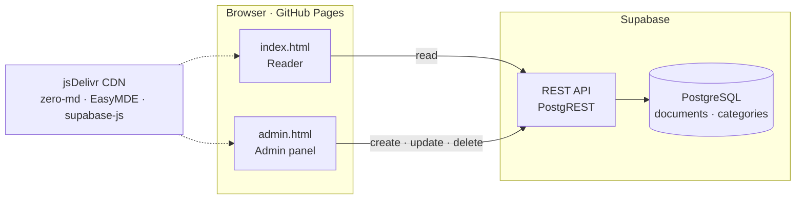

# Codex

<p align="center">
  
</p>

<p align="center">
  A Markdown knowledge base with a built-in admin panel, powered by Supabase and served as a static site.<br />
  <a href="https://bernardo-qg.github.io/codex-viewer/"><strong>Live site</strong></a> ·
  <a href="docs/adr/README.md">Architecture decisions</a> ·
  <a href="README.es.md">Leer en español</a>
</p>

## Features

**Reader**

- Documents grouped by category in a sidebar, with manual ordering
- Instant search by title or category (`/` to focus, `Enter` to open, `Esc` to clear)
- Table of contents for each document, highlighting the section you are reading
- One-click copy button on code blocks
- "Last updated" date for every document
- Client-side routing with shareable URLs (`?doc=<slug>`), working back and forward buttons and a mobile-friendly layout

**Admin panel** (`admin.html`)

- Create, edit and delete documents with a Markdown editor
- Assign a category and order, then open the published page in one click
- Slug format validation and friendly duplicate-slug errors

## Architecture



There is no backend and no build step: two HTML pages talk directly to Supabase's auto-generated REST API, and GitHub Pages serves the files as they are.

### Key decisions

Each decision is recorded as an [Architecture Decision Record](docs/adr/README.md) (in Spanish):

| Decision | Why |
| --- | --- |
| [Static site, no build](docs/adr/0002-sitio-estatico-sin-compilacion.md) | Free hosting, zero dependencies, nothing to maintain beyond the code itself |
| [Client-side Markdown rendering](docs/adr/0003-renderizar-markdown-con-zero-md.md) | A single web component handles rendering, syntax highlighting and style isolation through the Shadow DOM |
| [Supabase as the content store](docs/adr/0004-supabase-como-almacenamiento.md) | Edit notes from the browser without commits; real SQL with a versioned schema |
| [Categories as a separate table](docs/adr/0006-categorias-y-orden-de-documentos.md) | Orderable groups, with graceful fallback if the schema hasn't been migrated yet |
| [Public key + Row Level Security](docs/adr/0007-seguridad-con-llave-publicable-y-rls.md) | On a static site the API key is necessarily public, so authorization lives in the database *(in progress)* |

### Engineering notes

- **XSS-safe rendering:** every database value inserted with `innerHTML` is escaped.
- **Race-condition guard:** a request counter ensures a slow response can never overwrite a document opened afterwards.
- **Graceful degradation:** if a newer column or table is missing, the app falls back to a simpler query instead of breaking.
- **Shadow DOM integration:** the table of contents and copy buttons are built from zero-md's rendered output using its `zero-md-rendered` event.

## Tech stack

HTML · CSS · JavaScript (ES modules) · [Supabase](https://supabase.com/) · [zero-md](https://github.com/zerodevx/zero-md) · [EasyMDE](https://github.com/Ionaru/easy-markdown-editor) · [Bruno](https://www.usebruno.com/) · GitHub Pages

## Project structure

```
├── index.html            Reader
├── admin.html            Admin panel
├── assets/
│   ├── js/
│   │   ├── config.js     Supabase URL and publishable key
│   │   ├── utils.js      Shared client, querying, sorting, list rendering, HTML escaping
│   │   ├── api.js        Reader logic: search, table of contents, copy buttons
│   │   └── admin.js      Admin panel logic
│   ├── css/              Site, admin and Markdown styles
│   ├── images/           Images referenced by documents
│   └── bruno/            API collection for Bruno
├── db/
│   ├── schema.sql        Tables, index and updated_at trigger
│   └── seed.sql          Sample data
└── docs/adr/             Architecture Decision Records
```

## Getting started

1. Create a Supabase project and run `db/schema.sql` in the SQL Editor.
2. Put the project URL and publishable key in `assets/js/config.js`.
3. Serve the folder locally. ES modules don't load from `file://`:

   ```bash
   python -m http.server 3000   # or "Open with Live Server" in VS Code
   ```

4. Open http://localhost:3000. Documents are managed from `/admin.html`; categories are created in SQL:

   ```sql
   INSERT INTO categories (name, slug, sort_order) VALUES ('Tools', 'tools', 1);
   ```

## Roadmap

- [ ] Admin authentication with Supabase Auth and Row Level Security ([ADR 0007](docs/adr/0007-seguridad-con-llave-publicable-y-rls.md))
- [ ] Scheduled backup of all documents to Markdown files
- [ ] Category management and image uploads from the admin panel

## Conventions

- **Commits:** single-line [Conventional Commits](https://www.conventionalcommits.org/), e.g. `feat(admin): permite asignar categoria`.
- **Formatting:** `.editorconfig` (4 spaces, UTF-8) and `.gitattributes` (LF line endings).
- **Schema changes** go into `db/schema.sql` in the same commit; notable changes go into the [CHANGELOG](CHANGELOG.md).

## Security

See [SECURITY.md](SECURITY.md).

## License

[MIT](LICENSE) © 2026 [Bernardo Quintino Guzmán](https://github.com/Bernardo-QG)
